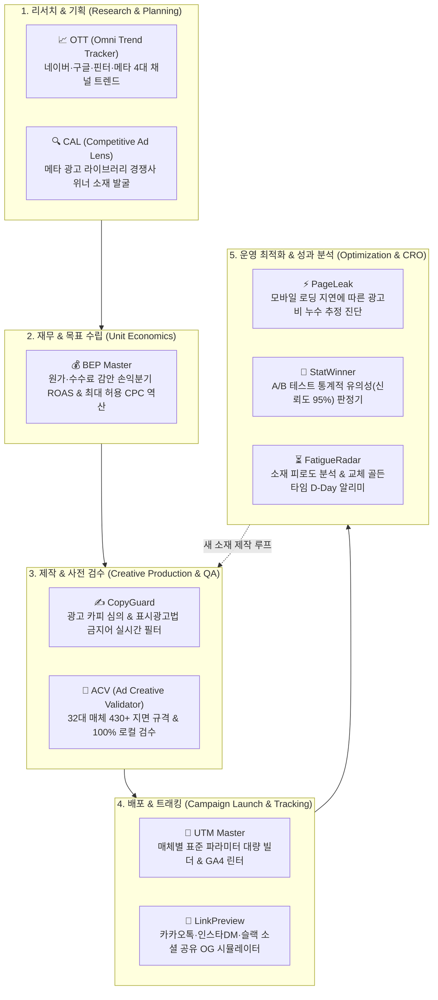

# Greycity Marketing Suite — Product Roadmap & Backlog

> **Vision:** 매체사(메타·네이버·구글)의 일방적인 광고비 유도에서 벗어나, **퍼포먼스 대행사 AE와 중소광고주가 매일 겪는 실제 운영 난제와 손익 누수를 오픈소스와 공개 API로 해결하는 독립 마케팅 오퍼레이션 플랫폼**.

---

## 1. 전체 마케팅 생태계 아키텍처 (Funnel Workflow)

---

## 2. 제품군 상세 백로그 (Product Factsheets)

### 🟢 기구축 완료 (Live Services)

#### 1. ACV (Ad Creative Validator) — v2.1 Pro
* **상태**: 🟢 로컬 가동 중 (`http://localhost:5173`)
* **핵심 역할**: 32대 국내외 광고 매체(네이버, 카카오, 메타, 구글, 토스, 쿠팡, 당근 등) 430+ 공식 지면 원클릭 규격 자동 검수.
* **차별점**: 
  * 서버 전송 0 byte, 브라우저 로컬 메모리 100% 검증으로 대외비 신제품 소재 유출 원천 차단.
  * 텍스트 20% 세이프존 자동 감지 게이지 및 규격 미달 원인 1초 시각화.
* **기술 스택**: Vite, React 18, TypeScript, Tailwind CSS, HTML5 Canvas API.

#### 2. OTT (Omni Trend Tracker) — v1.1 Pro
* **상태**: 🟢 로컬 가동 중 (`http://localhost:5174`), GitHub 배포 완료
* **핵심 역할**: 네이버 데이터랩, 구글 트렌드, 핀터레스트, 메타 인스타그램의 키워드 검색량과 트렌드 곡선을 한눈에 비교.
* **차별점**:
  * 핀터레스트의 2~3개월 선행 시즈널 피크와 네이버의 실제 구매 의도 지수를 크로스 분석.
  * ACV와의 양방향 이동 스위처 탑재 (키워드 발굴 ➔ 소재 검수 원클릭 연결).
* **기술 스택**: FastAPI, Python 3.9, NAVER API HUB 공식 엔드포인트, Meta Graph API v21.0, Pinterest API v5, pytrends.

---

### 🚀 신규 파이프라인 (Candidate Pipeline)

#### 3. CAL (Competitive Ad Lens) — 🥇 차기 개발 1순위
* **컨셉**: 메타 광고 라이브러리(Meta Ad Library) 공식 공개 API 기반의 **경쟁사 라이브 소재 역분석 & 위너(Winner) 소재 탐지기**.
* **해결하는 페인 포인트**:
  * 경쟁사가 현재 돌리고 있는 배너/영상 소재와 카피를 모니터링하기 위해 메타 사이트를 일일이 뒤지는 비효율 제거.
  * 어떤 소재가 진짜 성과가 좋은지 알 수 없었던 문제를 **"집행 기간(Duration)"** 역산으로 해결.
* **핵심 기능**:
  1. **Winner Creative 뱃지**: 30일~60일 이상 꺼지지 않고 계속 집행 중인 '검증된 위너 소재' 자동 판별.
  2. **포맷별 믹스 통계**: 영상 vs 단일 이미지 vs 캐러셀 비중 분석.
  3. **ACV 즉시 전송**: 경쟁사의 배너 이미지를 원클릭으로 ACV에 넣어 규격 및 텍스트 비율 역분석.
* **활용 기술/API**:
  * `Meta Ad Library API` (완전 무료 공식 엔드포인트: `https://graph.facebook.com/v21.0/ads_archive`)
  * 기존 발급받은 Meta 개발자 계정(`1450941336450931`) 즉시 활용 가능.

#### 4. UTM Master (스마트 캠페인 빌더 & GA4 네이밍 린터) — 🥈 차기 개발 2순위
* **컨셉**: 마케터가 매일 실수하여 GA4 보고서 데이터를 망가뜨리는 **UTM 파라미터 오타·대소문자 불일치 방지 및 대량 생성기**.
* **해결하는 페인 포인트**:
  * `facebook`과 `Facebook`, `cpc`와 `CPC`처럼 사소한 대소문자 차이로 GA4 소스/매체 데이터가 영구적으로 분열되는 사고 원천 방지.
* **핵심 기능**:
  1. **32대 매체 공식 프리셋**: 네이버 검색/GFA, 카카오 모먼트, 구글 SA/PMax 등 매체별 공식 동적 파라미터(`{keyword}`, `{{campaign.id}}` 등) 자동 완성.
  2. **엑셀 대량 생성(Batch)**: 수십 개 URL을 복사해 넣으면 규칙대로 한 번에 클린 생성.
  3. **GA4 공식 네이밍 린터**: 공백, 한글, 특수문자, 대소문자 위반 즉시 자동 교정.
  4. **링크 유효성 사전 검사**: 생성된 URL이 실제로 열리는지(`HTTP 200` vs `404`) 백그라운드 체크.
* **활용 기술/API**:
  * 100% 브라우저 메모리 로컬 자바스크립트 엔진 + 오픈소스 단축 URL(Dub.co) API.

#### 5. BEP Master (순마진 & 손익분기 ROAS/허용 CPC 역산기) — 🥉 차기 개발 3순위
* **컨셉**: 대행사 미팅과 광고주 예산 수립 시 필수적인 **재무적 손익분기(Break-Even Point) & 한계 ROAS 계산기**.
* **해결하는 페인 포인트**:
  * 매체 대시보드상 ROAS 300% 찍혔는데 정작 제품 원가와 플랫폼 수수료 떼고 나면 적자 나는 사태 방지.
* **핵심 기능**:
  1. **플랫폼 수수료 프리셋**: 스마트스토어(연동 2~5.5%), 자사몰 PG(3.3%), 쿠팡(10.8%), 에이블리/지그재그(15%) 등 입점처 수수료 자동 반영.
  2. **한계 ROAS & Max CPC 역산**: 목표 순이익률 달성을 위해 지불 가능한 최대 CPC 역산.
  3. **민감도 매트릭스(Sensitivity Matrix)**: "CPC가 100원 오를 때", "상세페이지 전환율이 0.3% 변할 때" 순이익 변화를 표로 시각화.
  4. **광고주 제안용 카드 출력**: 대행사 AE가 제안서/카톡 보고에 바로 붙여넣는 프로페셔널 카드 뷰.

#### 6. PageLeak (랜딩페이지 광고비 누수 진단기)
* **컨셉**: 클릭당 수천 원을 지불하고 유입된 고객이 랜딩페이지 어디서 이탈하여 광고비가 버려지는지 진단.
* **핵심 기능**:
  1. **모바일 로딩 지연에 따른 버려진 광고비(Wasted Spend) 추정**: "모바일 첫 화면 로딩 3.4초 지연으로 월 광고비 중 약 120만원이 첫 화면을 보지도 못하고 이탈 중입니다".
  2. **모바일 뷰포트 결제 버튼 가시성 점검**: 아이폰/갤럭시 해상도에서 CTA 버튼 가려짐 여부 자동 캡처.
* **활용 기술/API**: Google PageSpeed Insights API (무료), Playwright 헤드리스 캡처.

#### 7. StatWinner (A/B 테스트 통계적 유의성 판정기)
* **컨셉**: 소재 A vs B 실험 시 "단순 운인지, 진짜 승자인지" 통계적 신뢰도(P-value < 0.05)를 검증.
* **핵심 기능**:
  1. 노출수와 클릭/전환수만 입력하면 "현재 신뢰도 84% (결론 도출까지 350회 노출 추가 필요)" 안내.
  2. "95% 확신으로 B 소재 승리 확정! 안심하고 A를 끄셔도 됩니다" 명확한 액션 가이드.
* **활용 기술**: JavaScript `jStat` (Z-test, Chi-square 통계 엔진).

#### 8. CopyGuard (광고 카피 심의 & 표시광고법 위반 검수기)
* **컨셉**: 광고 등록 즉시 승인 반려(Disapproved)를 유발하는 표시광고법/매체별 금지어 실시간 린터.
* **핵심 기능**:
  1. 카피 입력 시 🔴 즉시 반려 단어(최고, 1위, 치료, 완치 등) 및 🟡 소명 필요 단어 실시간 하이라이트.
  2. 전환율(CTR)을 유지하는 대체 세일즈 카피 추천.
* **활용 기술**: 공정거래위원회 부당 표시광고 심사지침 데이터, 한국어 형태소 분석기 (Kiwi WASM).

#### 9. FatigueRadar (소재 피로도 & 교체 골든타임 D-Day 알리미)
* **컨셉**: 타겟 모수 소진으로 빈도(Frequency)가 치솟고 효율이 꺾이기 전, 새 소재 투입 골든타임을 D-Day로 사전 경고.
* **핵심 기능**:
  1. 최근 7일 빈도와 CTR 하락 추세를 기반으로 소재 잔여 수명 예측.
  2. "현재 소재 수명 약 3.8일 남음 (목요일까지 신규 소재 투입 권장)" 경고 및 ACV 연결.

---

## 3. 우선순위 매트릭스 (Effort vs. Impact)

| 순위 | 도구명 | 개발 공수 | 실무 파급력 | 핵심 대상 |
| :---: | :--- | :---: | :---: | :--- |
| **1** | **CAL (경쟁사 위너 소재 분석)** | 1~2일 | ⭐⭐⭐⭐⭐ | 퍼포먼스 마케터, 대행사 AE, 브랜드 기획자 |
| **2** | **UTM Master (스마트 파라미터 빌더)** | 0.5일 | ⭐⭐⭐⭐⭐ | 대행사 신입~시니어, 그로스 마케터, 데이터 분석가 |
| **3** | **BEP Master (손익분기 ROAS 계산기)** | 0.5일 | ⭐⭐⭐⭐⭐ | 대행사 영업팀, 중소 이커머스 대표, 미디어 플래너 |
| **4** | **StatWinner (A/B 테스트 유의성 판정)** | 0.5일 | ⭐⭐⭐⭐ | 그로스 마케터, CRO 담당자 |
| **5** | **PageLeak (랜딩페이지 누수 진단)** | 1~2일 | ⭐⭐⭐⭐ | 중소광고주, 웹 디자이너, 퍼포먼스 마케터 |
| **6** | **CopyGuard (카피 심의 검수)** | 1일 | ⭐⭐⭐⭐ | 광고 집행 실무자, 대행사 카피라이터 |
