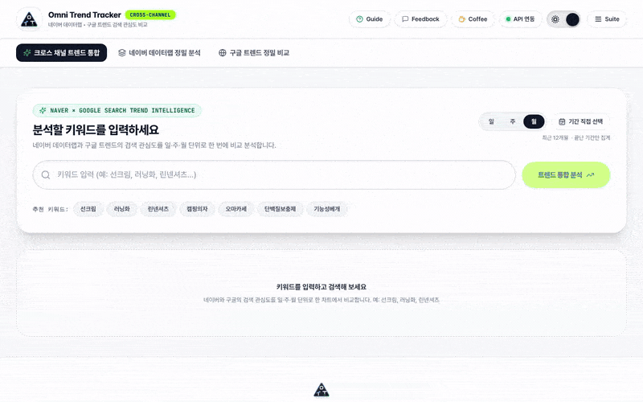

# Omni Trend Tracker (OTT)

> 네이버와 구글의 검색 관심도를 **일·주·월 단위로 한 차트에서** 비교하는 무료 대시보드



**바로 쓰기: https://omni-trend-tracker.vercel.app** (가입 없음, 무료)

[](https://fastapi.tiangolo.com)
[](https://react.dev)
[](https://vitejs.dev)
[](LICENSE)

---

## 3단계로 쓰기

1. **키워드를 넣습니다.** 예: 선크림, 러닝화, 린넨셔츠
2. **단위를 고릅니다.** 일(최근 30일) · 주(최근 52주) · 월(최근 12개월). 캠페인 기간처럼 날짜를 직접 고를 수도 있습니다.
3. **결과를 봅니다.**
   - 두 채널의 관심도를 0~100 지수로 겹친 차트
   - 채널별 직전 기간 대비 변화율
   - 기간 중 관심도가 가장 높았던 시점
   - 구글 연관 검색어

더 자세히 보고 싶으면 상단 탭의 **정밀 분석 스튜디오**를 씁니다.
- **네이버 데이터랩:** 주제어 그룹 최대 5개를 기기(PC·모바일)·성별·연령 필터로 비교
- **구글 트렌드:** 키워드 최대 5개를 지역(전국·서울·경기·미국·일본·전세계)과 검색 유형(웹·유튜브·쇼핑·뉴스)별로 비교

---

## 무엇을 보여 주나

| | 네이버 | 구글 |
|---|---|---|
| 출처 | 네이버 데이터랩 검색어 트렌드 API | Google Trends (`pytrends`) |
| 값 | 기간 중 최고점을 100으로 둔 상대 지수 | 기간 중 최고점을 100으로 둔 상대 지수 |
| 지역 | 한국 | 한국 (스튜디오에서 지역 선택) |
| 연관 키워드 | 함께 검색해 볼 조합 (예시로 표시) | 구글이 알려 준 실제 연관 검색어 |

- **끝난 기간만 셉니다.** 일 단위는 어제까지, 주 단위는 지난 일요일까지, 월 단위는 지난달까지입니다. 반쯤 지난 주나 달을 넣으면 마지막 값이 늘 떨어져 보이기 때문입니다.
- **주는 월~일입니다.** 구글의 주(일~토)는 다음 월요일로 시작하는 주에 맞춥니다. 월 단위의 구글 값은 주별 값을 달마다 평균한 것입니다.
- **기간 직접 선택:** 2016-01-01부터 어제까지 고를 수 있습니다. 구글 제약 때문에 일 단위는 270일, 주 단위는 5년까지입니다.
- **0은 "데이터 부족"입니다.** 두 서비스 모두 검색량이 너무 적으면 0을 줍니다. 0이 들어간 변화율은 -100%로 쓰지 않고 "데이터 부족"으로 표시하고, 상승·하락 판정에서도 뺍니다.
- **실제 데이터가 아니면 밝힙니다.** 키가 없거나 조회에 실패한 채널은 예시 데이터로 채우고, 카드에 "예시 데이터", 차트에 점선과 "(예시)"를 붙입니다. 요약 문장은 실제 데이터 채널만으로 만듭니다.

---

## 알려진 제한

- **실제 검색 건수가 아닙니다.** 두 채널 모두 상대 지수입니다. "네이버 70, 구글 40"은 검색량 비교가 아니라 각 채널 안에서의 흐름입니다.
- **구글은 비공식 경로로 가져옵니다.** `pytrends`는 구글이 공개한 API가 아닙니다. 짧은 시간에 많이 조회하면 구글이 몇 분~십여 분 막습니다(429). 그동안 구글 채널은 예시 데이터로 표시됩니다.
- **네이버 키의 하루 호출 한도를 모든 방문자가 나눠 씁니다.** 한도를 넘으면 그날은 네이버가 예시 데이터로 표시됩니다.
- **요청 제한과 캐시는 서버 인스턴스마다 따로입니다.** 같은 키워드·기간은 10분간 캐시하고, 캐시되지 않은 조회는 방문자당 1분에 10회로 제한합니다. 방문자가 몰려 Vercel이 서버를 여러 개 띄우면 각자 따로 셉니다.
- **응답 시간:** 운영 서버(서울)에서 측정한 결과 1.5~4.5초였습니다. 채널 하나가 20초 안에 답하지 않으면 그 채널만 예시 데이터로 바꿔 보여 줍니다.
- **데스크톱 기준으로 만들었습니다.** 모바일에서도 쓸 수 있지만 일부 카드 글자가 잘립니다.

---

## 직접 실행하기

### 1. 백엔드 (FastAPI)
```bash
cd backend
python3 -m venv .venv          # Python 3.10 이상 (3.12에서 테스트)
source .venv/bin/activate
pip install -r requirements.txt
cp .env.example .env           # 선택: 네이버 키를 넣으면 네이버가 실제 데이터로 바뀝니다
python run.py                  # http://localhost:8000
```

네이버 키는 네이버 클라우드의 [NAVER API HUB 검색어 트렌드](https://api.ncloud-docs.com/docs/naver-api-hub-search-trend)에서 받습니다. 예전에 네이버 개발자 센터에서 받은 데이터랩 키도 쓸 수 있습니다. 구글은 키가 필요 없습니다.

### 2. 프런트엔드 (React + Vite)
```bash
cd frontend
npm install
npm run dev                    # http://localhost:5174 (/api는 8000번으로 전달)
```

### 테스트
```bash
cd backend && pip install pytest && python -m pytest -q      # 65개
cd frontend && npx tsc --noEmit && npm run build
```
GitHub Actions가 PR과 `main` 푸시마다 같은 검사를 돌립니다.

### Vercel 배포
저장소를 그대로 Import하면 됩니다(Application Preset: **Other**). `vercel.json`이 다음을 처리합니다.
- `frontend/`를 빌드합니다.
- `api/index.py`를 Python 함수(서울 리전)로 올리고, 보안 헤더를 붙입니다.

환경변수 `NAVER_CLIENT_ID`, `NAVER_CLIENT_SECRET`을 Production과 Preview에 넣습니다.

---

## 기술 스택

- **Frontend:** React 18, TypeScript, Vite 6, Tailwind CSS, Recharts, Lucide Icons
- **Backend:** Python, FastAPI, pytrends, pandas, Pydantic
- **배포:** Vercel (정적 파일 + Python 함수 하나)

Marketing Intelligence Suite의 하나입니다.
- [ACV](https://ad-creative-validator.vercel.app): 광고 소재 규격 검수
- [BEP Master](https://bep-master.vercel.app): 손익분기 ROAS 계산
- OTT: 이 저장소

[개인정보처리방침](PRIVACY_POLICY.md) · 건의는 [GitHub 이슈](https://github.com/Greycity1988/omni-trend-tracker/issues)로 남겨 주세요.

## 라이선스

[MIT License](LICENSE). Crafted in 2026 by Owen O. Magnus.
